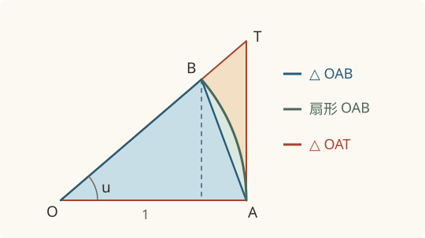

# 微积分 两个重要极限

[[微积分课程笔记|返回课程目录]]

对应教材为《微积分》上册（第三版）§1.5，书页 55–64。

## 正弦的第一个重要极限（第 16–17 页）

$$
\lim_{u\to0}\frac{\sin u}{u}=1\qquad (u\text{ 用弧度表示}).
$$

在单位圆上固定 $A=(1,0)$，从圆心 $O$ 画一条与 $OA$ 成 $u$ 角的射线，$0<u<\pi/2$。它先交圆于 $B$，再交过 $A$ 的切线于 $T$。两个三角形都可取 $OA$ 为底，扇形的面积夹在它们之间。

$B$ 到底边的高为 $\sin u$，$T$ 到底边的高为 $\tan u$。扇形占整圆的 $u/(2\pi)$，面积为 $u/2$；这一步用到了弧度制。由三个面积的大小得到
$$
\frac{\sin u}{2}<\frac u2<\frac{\tan u}{2}.
$$
左边给出 $\sin u/u<1$，右边乘上 $\cos u/u>0$ 得 $\cos u<\sin u/u$。当 $u\to0^+$ 时两端同趋于 $1$。负侧由 $\sin u/u$ 的偶性得到。若正弦里的角为 $\varphi(x)\to0$，先凑出 $\sin\varphi(x)/\varphi(x)$，再算剩下的因子。

**角度放大不同的倍数（第 17 页）。** 求 $\lim_{x\to0}\sin(mx)/\sin(nx)$，其中 $m,n\ne0$。希望分子、分母各出现一组相同的角。给 $\sin(mx)$ 配上 $mx$，给 $\sin(nx)$ 配上 $nx$，原式就变为
$$
\frac{\sin(mx)}{mx}\cdot\frac{m}{n}\cdot\frac{nx}{\sin(nx)}
\longrightarrow\frac mn.
$$

**余弦差中的二阶量（同页）。** [[微积分 三角公式与数列极限|半角公式]]把二阶的零拆开：
$$
\frac{1-\cos x}{x^2}=\frac12\left(\frac{\sin(x/2)}{x/2}\right)^2
\longrightarrow\frac12 \qquad(x\to0).
$$

把这个结果和正切极限合用，还可以处理相减后的一项：
$$
\frac{\tan x-\sin x}{x^3}=\frac{\tan x}{x}\frac{1-\cos x}{x^2}\longrightarrow\frac12.
$$
这里先提取因子，保住了[[微积分 无穷小的比较与等价替换|相减之后剩余的高阶项]]。

> [!example]- 第 17 页其余变式：振荡因子、正切与趋近点平移
> $\displaystyle\frac{x^2\sin(1/x)}{\sin x}=\frac{x}{\sin x}\,x\sin(1/x)\to0$（$x\to0$）。第一因子趋于 $1$，第二因子的绝对值不超过 $|x|$。
>
> $\displaystyle\frac{\tan x}{x}=\frac{\sin x}{x}\frac1{\cos x}\to1$（$x\to0$）。
>
> 当 $x\to\pi$，令 $t=\pi-x$。则 $\sin 3x=\sin3t$，$\tan5x=-\tan5t$，所以 $\sin(3x)/\tan(5x)\to-3/5$。周期平移会改变本题分子的符号相对于分母的关系。
>
> $\displaystyle\lim_{x\to x_0}\frac{\sin(x-x_0)}{x-x_0}=1$，取 $u=x-x_0$ 即可。
>
> $\displaystyle\lim_{x\to1}(1-x)\tan\frac{\pi x}{2}$：令 $u=1-x$、$v=\pi u/2$，原式为 $u\cot v=\frac2\pi\frac v{\sin v}\cos v\to2/\pi$。

## 指数型的第二个重要极限（第 18–19 页）

$$
\lim_{x\to+\infty}\left(1+\frac1x\right)^x
=\lim_{x\to-\infty}\left(1+\frac1x\right)^x
=\lim_{u\to0}(1+u)^{1/u}=e.
$$

**先证整数情形。** 记 $a_n=(1+1/n)^n$。对 $1$ 与 $n$ 个 $1+1/n$ 用算术－几何平均不等式，得 $a_n<(1+1/(n+1))^{n+1}=a_{n+1}$。另一方面，二项展开中第 $k$ 阶项 $\binom nk/n^k\le1/k!$，且 $k!\ge2^{k-1}$（$k\ge1$），所以
$$
a_n\le 1+\sum_{k=1}^n\frac1{k!}
\le1+\sum_{k=1}^n 2^{1-k}<3 .
$$
单调有界保证极限存在，将此数记为 $e$。

**再把整数推广到实数。** 取 $n=\lfloor x\rfloor$，则 $x\to+\infty$ 时
$$
\left(1+\frac1{n+1}\right)^n
\le\left(1+\frac1x\right)^x
\le\left(1+\frac1n\right)^{n+1}.
$$
左端为 $a_{n+1}/(1+1/(n+1))$，右端为 $a_n(1+1/n)$，两者都趋于 $e$。当 $x\to-\infty$，取 $t=-x\to+\infty$，则 $(1+1/x)^x=(1+1/(t-1))^t\to e$。最后令 $u=1/x$，即得 $u\to0$ 的写法。

**如何算 $1^\infty$ 型。** 若 $u\to0$、$uv\to L$，在底数 $1+u>0$ 时有 $(1+u)^v\to e^L$。当 $u\ne0$，把原式写为 $\big[(1+u)^{1/u}\big]^{uv}$ 即可看出原因。$u$ 偶尔为零时该处原式恰为 $1$，相应的 $uv$ 也为零。解题时先认出底数中的增量 $u$，再计算“增量乘指数”。

| 原题（第 19 页） | 增量乘指数 | 极限 |
| --- | --- | --- |
| $\displaystyle(1-1/x)^x$，$\lvert x\rvert\to\infty$ | $(-1/x)x=-1$ | $1/e$ |
| $\displaystyle\left(\frac{3+x}{2+x}\right)^{2x}$，$\lvert x\rvert\to\infty$ | 底数为 $1+\frac1{x+2}$，乘积为 $\frac{2x}{x+2}\to2$ | $e^2$ |
| $\displaystyle(1+3\tan^2x)^{\cot^2x}$，$x\to0$ | $3\tan^2x\cot^2x=3$ | $e^3$ |
| $\displaystyle(1-m^2/n^2)^n$，固定 $m\ne0$，$n\to\infty$ | $-m^2/n\to0$ | $1$ |
| $\displaystyle\left(1+\frac{2nx+x^2}{2n^2}\right)^{-n}$，固定 $x$，$n\to\infty$ | $-x-\frac{x^2}{2n}\to-x$ | $e^{-x}$ |

## 复查公式表里的趋近方向

《微积分上重要公式》（文件名为“3.微积分公式总结”）PDF 第 1 页和《高数公式手册》PDF 第 2 页，都把若干无穷远极限排在一起。用表前先写出趋近方向和自变量的取值范围。

- 对于首项系数不为零的多项式，若分子、分母的次数分别为 $n,m$，无穷远处的符号和增长阶由 $(a_0/b_0)x^{n-m}$ 决定。$n>m$ 时还需判断正负。例如 $-x^3/x^2=-x$ 在 $x\to+\infty$ 时趋于 $-\infty$。
- 对 $x^x$ 用 $e^{x\ln x}$，在实数范围内按 $x\to0^+$ 处理。因为 $x\ln x\to0$，极限才是 $1$。
- 对数列 $x^n$ 固定底数、令 $n\to\infty$。$x<-1$ 时绝对值无界，奇偶两列符号相反；$x=-1$ 时绝对值有界但仍振荡。单凭 $|x|>1$ 不能写成趋于正无穷。
