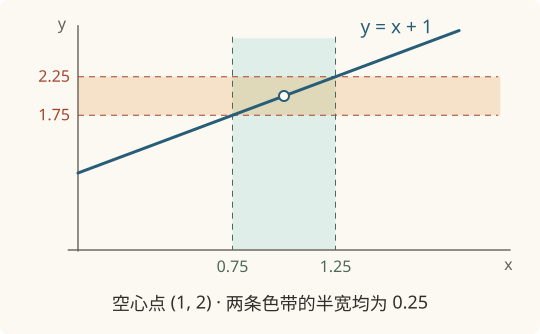

# 微积分 函数极限与无穷小量

[[微积分课程笔记|返回课程目录]]

对应教材为《微积分》上册（第三版）§1.2–1.4，书页 33–50。

## 自变量往哪里走（第 7–8 页）

讨论有限点的极限时，默认趋近点是定义域的聚点，即任意小的[[微积分 函数与读题准备|去心邻域]]内都有定义域中的点。单侧极限要求能从指定的一侧任意接近。

看 $f(x)=(x^2-1)/(x-1)$ 在 $x=1$ 附近的表现。原式在 $1$ 没有值，在其他点却与直线 $y=x+1$ 完全重合。若要求输出离 $2$ 不到 $0.25$，该允许输入离 $1$ 多远？

图中先给定水平的输出误差带，再选竖直的输入带。因为 $|f(x)-2|=|x-1|$，取 $0<|x-1|<0.25$ 就够了。把水平带收窄到任意半宽 $\varepsilon$，取同样的输入半宽 $\delta=\varepsilon$，整段图像仍会落进去。

这正是 $\lim_{x\to x_0} f(x)=A$ 的要求。对**每一个** $\varepsilon>0$，都能选取 $\delta>0$，使定义域里的**所有** $0<|x-x_0|<\delta$ 都满足 $|f(x)-A|<\varepsilon$。不等式中的 $0<$ 挖去了中心点，所以单改 $f(x_0)$ 不会改变极限。

改变趋近方向只需改变对 $x$ 的约束，误差要求相同。

| 过程 | 给定 $\varepsilon$ 后须覆盖的全部自变量 |
| --- | --- |
| $x\to x_0^-$ 或 $x\to x_0^+$ | 取 $\delta>0$，分别覆盖 $x_0-\delta<x<x_0$ 或 $x_0<x<x_0+\delta$ |
| $x\to+\infty$ 或 $x\to-\infty$ | 取 $X>0$，分别覆盖 $x>X$ 或 $x<-X$ |
| $\lvert x\rvert\to\infty$ | 取 $X>0$，同时覆盖 $\lvert x\rvert>X$ 的两端 |

**例 · 选取 $\delta$ 和 $X$（第 7–8 页）。**

- 对常数 $C$，$|C-C|=0$，任意 $\delta>0$ 都行。对 $f(x)=x$，要证 $x\to x_0$ 时 $f(x)\to x_0$，可直接取 $\delta=\varepsilon$。
- 本节开头的有理式对应同页的 $\lim_{x\to1}(x^2-1)/(x-1)$；图中取 $\delta=\varepsilon$ 利用了两种误差恰好相等。
- 当 $x_0>0$，取 $\delta=\min\{x_0,\varepsilon\sqrt{x_0}\}$，则 $0<|x-x_0|<\delta$ 时 $x>0$，且 $|\sqrt x-\sqrt{x_0}|=|x-x_0|/(\sqrt x+\sqrt{x_0})<\varepsilon$。
- 当 $|x|\to\infty$，$|\sin x/x|\le1/|x|$。取 $X=1/\varepsilon$ 即证 $\sin x/x\to0$。同理 $1/x$ 在两端都趋于 $0$。而 $\arctan x$ 在正、负无穷处分别趋于 $\pi/2,-\pi/2$，两端没有共同极限。

## 分段点与振荡（第 8–10 页）

在左右两侧都有定义点趋近 $x_0$ 时，双侧极限存在，当且仅当左右极限都存在且相等。分界点上的单个函数值不参与两侧计算。

| 原题 | 左极限 | 右极限 | 双侧极限 |
| --- | --- | --- | --- |
| $x\to0$，左边 $1-x$，右边 $x^2+1$ | $1$ | $1$ | $1$ |
| $x\to0$，$f(x)=\lvert x\rvert/x$ | 左边恒为 $-1$ | 右边恒为 $1$ | 不存在 |
| $x\to0$，左边 $5+x^2$，$f(0)=10$，右边 $x$ | $5$ | $0$ | 不存在 |
| $x\to1$，左边 $x-1$，右边 $x^2-1$ | $0$ | $0$ | $0$，即使 $f(1)$ 未给定 |

**保号与保序。** 若极限 $A>0$，取 $\varepsilon=A/2$，去心邻域内便有 $f(x)>A/2$。若该邻域内 $f(x)\le g(x)$ 且两极限分别为 $A,B$，则 $A\le B$。若已知 $A<B$，将保号性用于 $g-f$，即可得到足够靠近时 $f(x)<g(x)$。

**海涅定理。** $\lim_{x\to x_0}f(x)=A$ 当且仅当对每列定义域中的 $x_n\ne x_0$，只要 $x_n\to x_0$ 就有 $f(x_n)\to A$。证明极限不存在时，往往只需找两列函数值趋于不同数的点。

**例 · $\sin(1/x)$ 在 $0$ 附近的振荡（第 10 页）。** 取 $x_n=1/(n\pi)$，有 $\sin(1/x_n)=0$。再取 $y_n=1/(2n\pi+\pi/2)$，有 $\sin(1/y_n)=1$。两列均从右趋于 $0$，连右极限都不存在。

## 无穷小量与无穷大量（第 11–12 页）

无穷小量是在指定过程中趋于 $0$ 的变量。例如 $\sin x$ 对应 $x\to0$，$1/x$ 对应 $|x|\to\infty$，$(-1)^n/n$ 对应 $n\to\infty$。$f(x)\to A$ 等价于能写成 $f(x)=A+\alpha(x)$，其中 $\alpha(x)\to0$。实际取 $\alpha=f-A$ 即可。

有限个无穷小的和仍趋于 $0$。局部有界量乘无穷小也趋于 $0$，因为若 $|g|\le M$，就有 $|g\alpha|\le M|\alpha|$。因此有限个无穷小的乘积也趋于 $0$。

**例 · 哪个因子只需有界（第 11 页）。**

- $\displaystyle\lim_{|x|\to\infty}\frac{2x}{\sqrt{1+x^2}}\arctan\frac1x=0$。第一因子绝对值至多为 $2$，第二因子趋于 $0$。
- $\displaystyle\lim_{x\to0}x^2\sin\frac1x=0$，因为 $|x^2\sin(1/x)|\le x^2$。前一节已证明振荡因子单独没有极限。

记 $|f(x)|\to\infty$，表示对每个 $M>0$，在相应过程的足够后段总有 $|f(x)|>M$；若能分别保证 $f(x)>M$ 或 $f(x)<-M$，则写 $f(x)\to+\infty$ 或 $f(x)\to-\infty$。原笔记也用不带符号的 $\infty$ 表示绝对值趋于无穷。由倒数关系，$|f|\to\infty$ 蕴含 $1/f\to0$；若 $f\to0$ 且在去心邻域恒不为零，则 $1/|f|\to+\infty$。

**例 · 无界与趋于无穷的区别（第 12 页）。** 令 $f(x)=\sin(1/x)/x$，考察 $x\to0$。沿 $x_k=1/(2k\pi+\pi/2)$ 有 $f(x_k)=2k\pi+\pi/2\to+\infty$，所以原点附近无界。沿 $y_k=1/(2k\pi)$（$k\ge1$）却有 $f(y_k)=0$，故 $|f|$ 也不能趋于无穷。

**例 · 用 $M$ 证明。** 对 $1/(x-1)$，任给 $M>0$，取 $\delta=1/M$，只要 $0<|x-1|<\delta$，就有 $|1/(x-1)|>M$。在左侧趋于 $-\infty$，右侧趋于 $+\infty$。

## 下册对照：沿一条路成立够不够

一元极限可以将左右两侧分开检查。二元极限要覆盖所有从定义域趋近该点的方式。《微积分》第三版下册 §5.1 习题第 10（3）题，书页 10，PDF 第 20 页，给出

$$
f(x,y)=\frac{x^2y}{x^4+y^2}\quad ((x,y)\ne(0,0)),\qquad f(0,0)=0.
$$

沿 $y=0$ 恒为零，沿 $y=x^2$ 却恒为 $1/2$，立刻排除原点处的极限。它甚至在原点有两个偏导数，因为沿两条坐标轴函数都为零。这也给匿名《春季学期期末试卷》（文件名“1024年春季学期期末试卷”）PDF 第 1 页选择题 1 提供了反例：两个偏导数存在并不能推出连续或可微。本例是下册延伸。
