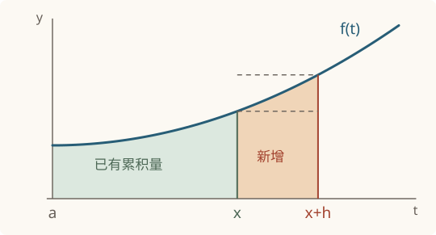

# 微积分 变上限积分、原函数与基本定理

[[微积分课程笔记|返回课程目录]]

课堂第 73–75 页。先分清三种对象：[[微积分 定积分、估值与和式极限|给定上下限的定积分]]是数；固定下限、让上限变化，得到函数；不定积分则表示一个区间上的全体原函数。

对应教材为《微积分》上册（第三版）§3.2–3.3，书页 211–218。

## 怎样对积分求导

让 $x$ 可以移动，把从 $a$ 到 $x$ 的累积量记成 $\Phi(x)=\int_a^x f(t)\,dt$。这里 $t$ 只在积分里从起点走到终点；$x$ 决定这一趟在哪里结束。先画一个 $f$ 为正的例子，取 $h>0$。上限右移时，绿色的旧面积仍在，真正新增的是右侧宽为 $h$ 的窄条。

因此 $\Phi(x+h)-\Phi(x)=\int_x^{x+h} f(t)\,dt$。除以宽 $h$ 就得到新增部分的平均高度。假设 $f$ 在 $[a,b]$ 连续，积分中值定理使这个平均高度等于区间内某点的函数值。对 $h<0$，反向积分与负的 $h$ 同时换号，仍有
$$
\frac{\Phi(x+h)-\Phi(x)}h=\frac1h\int_x^{x+h}f(t)\,dt=f(\xi_h),\quad \xi_h\to x .
$$
$h\to0$ 时，这个中间点被两个端点夹向 $x$，所以 $f(\xi_h)\to f(x)$。这就得到 $\Phi'(x)=f(x)$（端点取单侧导数）。即使 $f$ 有负值，相同的推导对带符号的累积量仍成立。

若积分两端都是可导函数且落在 $f$ 的连续区间内，拆成两个变上限积分，再用[[微积分 求导法则与复合函数|链式法则]]：
$$
\frac d{dx}\int_{u(x)}^{v(x)}f(t)\,dt=f(v(x))v'(x)-f(u(x))u'(x).
$$

**例 1（第 73 页，补解）**　求 $\displaystyle\lim_{x\to0}\frac{\int_{\cos x}^{1}e^{-t^2}\,dt}{x^2}$。积分的长度为 $1-\cos x$，中值点趋于 $1$，所以极限是 $e^{-1}\lim_{x\to0}(1-\cos x)/x^2=1/(2e)$。

**例 2（第 74 页）**　$f$ 连续且恒正。证明 $F(x)=\int_0^x t f(t)\,dt\big/\int_0^x f(t)\,dt$ 在 $x>0$ 递增。分母为正，求导后合并成
$$
F'(x)=\frac{f(x)\int_0^x(x-t)f(t)\,dt}{\left(\int_0^x f(t)\,dt\right)^2}>0.
$$
这里被积函数在 $t=x$ 为零，但在 $0<t<x$ 严格为正，足以推出积分严格为正。

**例 3（第 74 页）**　若连续函数 $f$ 严格递减，证明 $G(x)=\int_0^x(x-2t)f(t)\,dt$ 严格递增。先把带 $x$ 的一项提出：
$$
G=x\int_0^x f(t)\,dt-2\int_0^x tf(t)\,dt,\qquad
G'(x)=\int_0^x[f(t)-f(x)]\,dt .
$$
$x>0$ 时被积函数为正（端点除外）；$x<0$ 时被积函数为负，但积分方向也反向。两侧均有 $G'>0$，且 $G$ 在零点连续。

## 怎样用原函数计算定积分

面积函数 $\Phi(x)=\int_a^x f(t)\,dt$ 已经是连续函数 $f$ 的一个原函数。假如从导数表中找到另一个较好算的原函数 $F$，它和 $\Phi$ 在每一点的导数相同，由中值定理知差 $F-\Phi$ 在整个区间上恒定。

从 $a$ 到 $b$，两者的增量因此也相同。$\Phi(a)=0$，而 $\Phi(b)$ 正是想求的积分，于是得到牛顿–莱布尼茨公式
$$
\int_a^b f(x)\,dx=F(b)-F(a).
$$

例如在 $[0,\sqrt3]$ 上对 $1/(1+x^2)$ 积分。已知 $\arctan x$ 的导数在这整段都等于被积函数，上端值为 $\pi/3$，下端值为 $0$，相减就得到 $\pi/3$。若换成 $\arctan x+5$，两端同时多出的 $5$ 会抵消。

> [!example]- 第 74 页课堂题：端点代入、分段与面积
> | 第 74 页课堂题 | 解法 |
> | --- | --- |
> | $\int_0^{\pi/2}(2\cos x+\sin x-1)\,dx$ | 原函数 $2\sin x-\cos x-x$，代入得 $3-\pi/2$。 |
> | $\int_0^{\sqrt3}\frac{dx}{1+x^2}$ | 选在全区间有定义的 $\arctan x$，得 $\pi/3$。 |
> | $[0,1]$ 上 $f=2x$，$(1,2]$ 上 $f=5$ | 在 $1$ 分段，$\int_0^2 f=1+5=6$。分点处改一个函数值不影响积分。 |
> | $\int_{-2}^{-1}\frac{dx}{x}$ | 用 $\ln\lvert x\rvert$，得 $\ln1-\ln2=-\ln2$。 |
> | $\int_{-2}^{2}\max(x,x^2)\,dx$ | 交点 $0,1$ 将区间分三段，依次积 $x^2,x,x^2$，得 $8/3+1/2+7/3=11/2$。 |
> | $y=\sin x$ 在 $[0,\pi]$ 与横轴围成的面积 | 此区间正弦非负，面积 $\int_0^\pi\sin x\,dx=2$。 |

**一个不能把中值点当常数的极限（第 74 页）**　证 $\int_0^{\pi/2}\sin^n x\,dx\to0$。中值点 $\xi_n$ 随 $n$ 变动，$\sin\xi_n<1$ 本身无法推出 $(\sin\xi_n)^n\to0$。固定 $0<\delta<\pi/2$，在 $\pi/2-\delta$ 分段：
$$
0\le\int_0^{\pi/2}\sin^n x\,dx
\le \tfrac{\pi}{2}(\cos\delta)^n+\delta.
$$
先取 $n\to\infty$，上极限至多 $\delta$；再令 $\delta\downarrow0$。

## 不定积分和积分曲线族

在同一个区间上，若 $F'=f$，全体原函数写作 $\int f(x)\,dx=F(x)+C$。同一横坐标处，各条曲线的切线斜率均为 $f(x)$；改变 $C$ 只让图形上下平移。课堂第 75 页举的是 $\int\cos x\,dx=\sin x+C$ 和 $\int 2x\,dx=x^2+C$。

**教材补例（书页 218，例 2）**　已知曲线上每一点的切线斜率为 $2x$，且曲线过 $(1,2)$。斜率条件先给出整族 $y=x^2+C$，点的条件再选出 $C=1$。答 $y=x^2+1$。这是本次手记最后一页对应的知识点。

**分段原函数怎样接起来（《微积分（上）笔记》PDF 第 18 页，第 1 题，由原选择题改写）。** 对 $0\le x\le1$ 取 $f(x)=x^2$，对 $1<x\le2$ 取 $f(x)=2-x$。写出 $[0,2]$ 上满足 $F(0)=0$ 的原函数。左段由初值得 $F(x)=x^3/3$，因此 $F(1)=1/3$。右段先写成 $2x-x^2/2+C$。要在 $1$ 处可导，函数值先得接上，故 $3/2+C=1/3$，即 $C=-7/6$。最后验左右导数，均为 $1=f(1)$。所以
$$
F(x)=\begin{cases}
x^3/3,&0\le x\le1,\\
2x-x^2/2-7/6,&1<x\le2.
\end{cases}
$$
若去掉初值，整个式子可以再加同一个常数。两段各自任意加常数，会把接点拆开。

**条件辨析（课堂第 73 页）**　连续是存在原函数的充分条件。例 $H(x)=x^2\sin(1/x^2)$（$x\ne0$）、$H(0)=0$，则 $H'(0)=0$，而 $x\ne0$ 时
$$
H'(x)=2x\sin(1/x^2)-\frac2x\cos(1/x^2).
$$
$H'$ 在零点附近无界，却有原函数 $H$，所以在含零点的闭区间上，“有原函数”也不能保证通常意义的黎曼可积。反过来，有跳跃的阶梯函数可积，但跨越跳跃点的区间上没有原函数（导数具有介值性）。

## 从原函数到初值问题

布朗森《微分方程》第二版，第 1 章例 1.1 式（1.1），PDF 第 8 页，以 $y'=5x+3$ 为例。由原函数的定义，全部积分曲线为 $y=\tfrac52 x^2+3x+C$。若另外给出 $y(1)=0$，就须选 $C=-11/2$（此初值为整理时补设）。直接求导验方程，再代初值验常数，两步分别检查曲线的斜率和它经过的点。
