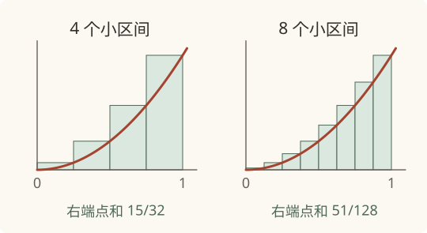

# 微积分 定积分、估值与和式极限

[[微积分课程笔记|返回课程目录]]

课堂第 69–72 页。题目给出许多越来越窄的小段时，从积分和出发；只问大小或极限时，先看能否比较被积函数。

对应教材为《微积分》上册（第三版）§3.1，书页 200–211。

## 黎曼和怎样变成积分

求 $y=x^2$ 在 $[0,1]$ 下的面积，先试着把底边切成四段，每段都用右端点的函数值作高。第二段覆盖 $[1/4,1/2]$，宽 $1/4$，高 $(1/2)^2=1/4$，贡献的是面积 $1/16$。其余各段也照这样“高乘宽”，然后才相加。

四个矩形总面积为 $15/32$，八个矩形为 $51/128$。两次都多算了，因为 $x^2$ 在这里递增，每段最高点恰是右端点。如果改取左端点，又会少算。等宽 $1/n$ 时两种总和之差恰为
$$
\frac1n\sum_{i=1}^n
\left[\left(\frac{i}{n}\right)^2-\left(\frac{i-1}{n}\right)^2\right]
=\frac1n.
$$
中间项两两消去，误差范围随 $n$ 增大而缩小。下面的定义允许任意分法，也允许在每段任取一点来算高度。

在 $[a,b]$ 上取分割 $a=x_0<\cdots<x_n=b$，记 $\Delta x_i=x_i-x_{i-1}$，每段选 $\xi_i\in[x_{i-1},x_i]$。若对任意分法和取点，只要 $\lambda=\max_i\Delta x_i\to0$，下式都趋于同一有限值，就定义
$$
\int_a^b f(x)\,dx=\lim_{\lambda\to0}\sum_{i=1}^n f(\xi_i)\Delta x_i .
$$
只令段数增多，可能始终留有一段很宽；等分时才自动有 $\lambda=(b-a)/n\to0$。区间上连续，或有界、除有限个第一类间断点外处处连续，都是可积的充分条件（教材第 204 页）。普通黎曼可积要求有界。

**两种建模（第 69 页）**　$f\ge0$ 时，用高为 $f(\xi_i)$ 的小矩形逼近面积。线密度为 $\mu(x)$ 的细杆，用 $\mu(\xi_i)\Delta x_i$ 逼近一段的质量，总质量是 $\int_a^b\mu(x)\,dx$。函数可变号时，定积分给出横轴上下的面积代数和；几何总面积用 $\int_a^b|f(x)|\,dx$。

**用定义算（第 70 页）**　$x^2$ 在 $[0,1]$ 连续，可等分后取右端点：
$$
\int_0^1 x^2\,dx=\lim_{n\to\infty}\frac1{n^3}\sum_{i=1}^n i^2
=\lim_{n\to\infty}\frac{n(n+1)(2n+1)}{6n^3}=\frac13.
$$

## 积分的运算及大小关系

积分对被积函数线性，对区间可加。$\int_a^a f=0$，交换上下限变号。在 $a<b$ 时，若 $f\le g$ 则 $\int_a^b f\le\int_a^b g$。由此，
$$
\left|\int_a^b f(x)\,dx\right|\le\int_a^b |f(x)|\,dx,\qquad
m(b-a)\le \int_a^b f(x)\,dx\le M(b-a)
$$
其中 $m\le f\le M$。上下限顺序和区间长度是估值题容易漏的两处。

- **第 70 页例 4。** 在 $[-2,0]$ 上 $e^x>x$。题目积分从 $0$ 到 $-2$，反向后变成 $\int_0^{-2}e^x\,dx<\int_0^{-2}x\,dx$。
- **第 71 页例 5。** 在 $[0,\pi]$ 有 $0\le\sin^3 x\le1$，故 $\pi/4\le\int_0^\pi(3+\sin^3x)^{-1}\,dx\le\pi/3$。
- **第 71 页例 6。** $\sin x/x$ 在 $[\pi/4,\pi/2]$ 递减（见 [[微积分 单调性与极值]]）。两端值为 $2\sqrt2/\pi$ 与 $2/\pi$，乘区间长度 $\pi/4$ 得 $1/2\le\int_{\pi/4}^{\pi/2}(\sin x/x)\,dx\le\sqrt2/2$。

## 平均值与变动区间

若 $f$ 在 $[a,b]$ 连续，$a<b$，存在 $\xi\in(a,b)$ 满足 $\int_a^b f=f(\xi)(b-a)$。证明是把积分除以区间长度，用上下界夹住平均值，再用连续函数的介值性。若再有连续权重 $g>0$，同理用 $mg\le fg\le Mg$ 后积分，再除以 $\int_a^b g>0$，可得
$$
\int_a^b f(x)g(x)\,dx=f(\xi)\int_a^b g(x)\,dx .
$$
后一题见课堂第 71 页例 9，亦见教材第 211 页习题 3.1 第 6 题。

**第 71 页例 7。** 若 $f$ 可导且 $f(t)\to1$（$t\to+\infty$），求 $\lim_{x\to+\infty}\int_x^{x+2}t\sin(3/t)f(t)\,dt$。积分等于 $2\xi\sin(3/\xi)f(\xi)$，其中 $x<\xi<x+2$，故 $\xi\to+\infty$。由 $\sin u/u\to1$，结果为 $6$。

**第 71 页例 8。** 固定 $k\in\mathbb N$，$\int_n^{n+1}x^ke^{-x}\,dx=\xi_n^ke^{-\xi_n}$，$n<\xi_n<n+1$。指数增长快于固定次幂，极限为 $0$。

## 把和式极限认成定积分

第 71–72 页例 10 中，先设 $x_i=i/n$，寻找步长 $1/n$。乘积先取对数，权重不精确时要估计替换误差。

1. $\displaystyle\sum_{i=1}^n\frac{n}{n^2+i^2}=\frac1n\sum_{i=1}^n\frac1{1+(i/n)^2}\to\int_0^1\frac{dx}{1+x^2}=\frac\pi4$。
2. $\displaystyle\sum_{i=1}^n\frac{\sin(\pi i/n)}{n+1/i}\to\int_0^1\sin(\pi x)\,dx=2/\pi$。分母换成 $n$ 时，每项误差绝对值至多 $1/n^2$，总误差至多 $1/n$。
3. 设 $\displaystyle P_n=\left[\prod_{i=1}^n(1+i/n)\right]^{1/n}$，则 $\ln P_n\to\int_0^1\ln(1+x)\,dx=2\ln2-1$，所以 $P_n\to4/e$。可用原函数 $(1+x)\ln(1+x)-(1+x)$ 核算。
4. 页底变式 $\displaystyle n\sum_{i=1}^n\frac{\sin(\pi i/n)}{n^2+i}$。写成 $\frac1n\sum \frac{\sin(\pi i/n)}{1+i/n^2}$，其中 $0\le i/n^2\le1/n$；删去分母修正带来的总误差至多 $1/n$，仍得 $2/\pi$。

和式确定了积分区间和被积函数。要继续算出数值，可以再用[[微积分 变上限积分、原函数与基本定理|牛顿–莱布尼茨公式]]，在端点代入一个原函数并相减。

## 学习指导补例

**矩形、曲边面积与梯形谁大？** 《微积分学习指导教程》（第 2 版）例 3.11，书页 127，PDF 第 138 页。设 $a<b$，$f>0$、$f'<0$、$f''>0$。把下列三个量从小到大排列：
$$
S_1=\int_a^b f(x)\,dx,\qquad S_2=(b-a)f(b),\qquad
S_3=\tfrac12(b-a)\bigl(f(a)+f(b)\bigr).
$$
由严格递减，内点 $x$ 满足 $f(x)>f(b)$，积分后得 $S_1>S_2$。再看端点之间的弦。由 $f''>0$，图像在弦下方，即在 $a<x<b$ 时
$$
f(x)<\frac{b-x}{b-a}f(a)+\frac{x-a}{b-a}f(b).
$$
对两边积分，右边正好等于梯形面积 $S_3$，故 $S_2<S_1<S_3$。第一个比较用单调性，第二个比较用曲线的弯曲方向。

**比完两个积分，怎样再和 $1$ 比？** 同书例 3.13，书页 128，PDF 第 139 页。将
$$
I_1=\int_0^{\pi/4}\frac{\tan x}{x}\,dx,\qquad
I_2=\int_0^{\pi/4}\frac{x}{\tan x}\,dx,\qquad 1
$$
排序。两个被积函数在 $0$ 处都按极限补为 $1$。当 $0<x<\pi/4$，由 $(\tan x-x)'=\tan^2x>0$ 得 $\tan x>x$，于是 $\tan x/x>1>x/\tan x$，积分即有 $I_1>I_2$。

为了和数 $1$ 比，要把区间长度算进去。$\tan x$ 在 $[0,\pi/4]$ 上严格凸，图像在连接 $(0,0)$ 和 $(\pi/4,1)$ 的弦下方。因此内点处 $\tan x<4x/\pi$，得到 $I_1<(\pi/4)(4/\pi)=1$。合起来是 $1>I_1>I_2$。原书用 $\tan x/x$ 的单调性估上界，这里的弦给出了同一个常数。

## 幂很大时，先在整个区间上找上界

傅英定、谢云荪主编《微积分》上册，合订扫描版书页 219–220，PDF 第 232–233 页，例 3。求 $\lim_{n\to\infty}\int_0^{\pi/4}\sin^n x\,dx$。在**整个积分区间**有 $0\le\sin x\le 1/\sqrt2<1$，所以

$$
0\le\int_0^{\pi/4}\sin^n x\,dx\le\frac{\pi}{4}\left(\frac1{\sqrt2}\right)^n\longrightarrow0.
$$

把上限换成 $\pi/2$ 后，区间上的最大值变成 $1$。仍可自行补证：任取 $0<\delta<\pi/2$，在 $[0,\pi/2-\delta]$ 以 $\cos^n\delta$ 估计，在最后长度为 $\delta$ 的小区间以 $1$ 估计。积分不超过 $(\pi/2-\delta)\cos^n\delta+\delta$。先让 $n\to\infty$，再让 $\delta\downarrow0$，仍得 $0$。

## 下册对照：改变积分次序前先画区域

《2024年微积分第6–7章讲座》PDF 第 2 页例 2 把区域写成 $0\le\theta\le\pi,\ 0\le r\le1+\cos\theta$。在极坐标下，$x=r\cos\theta,\ y=r\sin\theta$，还要把面积元换成 $r\,dr\,d\theta$。于是

$$
\iint_D xy\,dA=\frac14\int_0^\pi\sin\theta\cos\theta(1+\cos\theta)^4\,d\theta
=\frac14\int_{-1}^1 u(1+u)^4\,du=\frac{16}{15}.
$$

同一方法可检验匿名《春季学期期末试卷》PDF 第 1 页选择题 3。范围 $0\le y\le2,\ 0\le x\le\sqrt{2y-y^2}$ 等价于 $x\ge0,\ x^2+(y-1)^2\le1$。这是上方圆盘的右半边，从原点出发，射线角度为 $0\le\theta\le\pi/2$，出圆时 $r=2\sin\theta$。所以换元后 $r$ 从 $0$ 到 $2\sin\theta$，被积表达式为 $f(r\cos\theta,r\sin\theta)\,r$。这些是下册重积分题，课堂记录仍以一元定积分和原函数为止。
