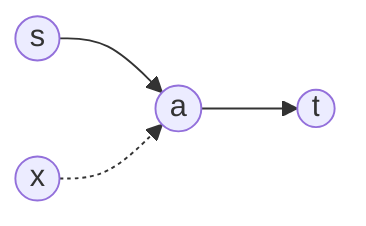

# 拓扑排序

拓扑序是有向图全部顶点的一种排列，每条边 $u\to v$ 的起点 $u$ 都在终点 $v$ 之前。把边理解为任务依赖，拓扑序就是一份可行的执行次序。有向图有拓扑序，当且仅当图中没有有向环。

## 入度与就绪队列

统计每个顶点的入度，即指向它的边数。入度为零的顶点没有未完成的前驱，可以进入队列。每取出一个顶点，就把它记入序列，并删去它的所有出边。某个后继的剩余入度降到零时，将它加入队列。

如果还有未输出的顶点而队列已经为空，每个剩余顶点至少有一个剩余前驱。沿着前驱往回走，有限步后必然遇到重复的顶点，形成有向环。这个过程称为 Kahn 算法，用邻接表存图时耗时 $O(V+E)$。多个顶点同时就绪时，先取哪一个会影响得到的合法序列。

## 可达子图

下面的有向图中，实线上的三个顶点可以从 $s$ 到达，虚线表示集合以外的顶点指向 $a$ 的边。

从 $s$ 出发，可以访问 $s,a,t$。只安排这三个顶点时，$a$ 在子图中只有一条入边，处理 $s$ 后就应当就绪。沿用全图的入度会让程序一直等着不在子图中的 $x$。

先通过[[有向可达性]]确定顶点集合，再只统计两端均在集合内的边，即可使用同一算法。

## 竞赛图

竞赛图的任意两个不同顶点之间恰有一条有向边，共有 $n(n-1)/2$ 条边。仅凭这个定义无法保证拓扑序存在，例如 $a\to b\to c\to a$ 已构成环。无环竞赛图的拓扑序则唯一，每对顶点间的边都直接规定了先后。

拓扑序约束的是边的两个端点在序列中的先后。另一种图上的遍历要求每条边恰走一次，见[[无向欧拉迹]]。

## 出处

旧题记《拓扑排序》《竞赛图》记录了子图入度和竞赛图的判定。Python 标准库的 `TopologicalSorter` 以各顶点的前驱为输入，可按批取出已就绪的顶点。[Python 文档 · graphlib](https://docs.python.org/3/library/graphlib.html)
