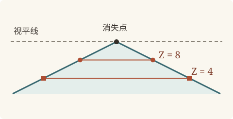

# 消失点

画一条向远处延伸的路，两边现实中始终等宽，落在画面上却会逼近同一点。把纸当成相机前方的一块透明平面，画面上的点就是从眼睛望向物体的那条射线与平面的交点。

## 同一方向决定同一个消失点

把相机放在原点，镜头朝 $Z$ 轴正方向，取画面为 $Z=f$。世界中一个点 $(X,Y,Z)$（$Z>0$）的画面坐标为

$$
x=f\dfrac{X}{Z},\qquad y=f\dfrac{Y}{Z}.
$$

把焦距取成 $f=1$，设相机水平，路面低于镜头一个单位。路的左右边缘分别在 $X=-2$ 和 $X=2$。在深度 $Z=4$ 处各放一块方形标记，画面上左右坐标为 $-1/2$ 和 $1/2$，相距 $1$。再往远处走，到 $Z=8$ 处各放一枚圆形标记。此时左右坐标变成 $\pm1/4$，相距只有 $1/2$。

看图上的两条横线，现实中它们横跨的都是同一条路。远处那条既变短了，也更靠近视平线，因为它的横坐标和纵坐标都要除以较大的 $Z$。若把标记一对一对放得更远，两端就会一起靠向图中的黑点。

朝向远方的一条直线可写为 $(X_0+at,Y_0+bt,Z_0+ct)$，其中 $c>0$。让 $t$ 增大，画面坐标趋向 $(fa/c,fb/c)$。这里用到[[微积分 函数极限与无穷小量|有理函数在无穷远处的极限]]：把分子、分母同除以 $t$，起点坐标所占的项趋于零，所以不同位置、方向相同的直线有同一个消失点。若 $c=0$，直线与画面平行，投影中仍可保持平行，其消失点在无穷远处。

## 画房间时先找哪几条线

世界中所有水平方向的消失点落在同一条线上，即视平线。眼前即使全是墙、看不到地平线，也能从两组柜沿或墙脚线的延长线估计这条线。

相机保持水平，正对一面墙画房间，墙面上横竖边与画面平行，墙角向深处的边收向一个消失点。向侧面转动视线看一个墙角，两组水平边的方向都向深处延伸，分别收向两个消失点。检查草图时，把同一组边各延长两条，再看另外几条是否也往同一区域靠。抬头看楼时，世界中的竖直线也可能在画面上汇聚。

## 出处

Ernest R. Norling《透视如此简单：20 步掌握透视基本原理》（上海人民美术出版社，2015），第 1–2 章讲视平线与消失点，第 3 章从平行线引入单点透视（印刷第 21 页起），第 5 章讲两点透视（第 39 页起）。正文用针孔投影重写了同方向直线汇聚的理由，两排路面标记用来验算。

[计算机与工程](计算机与工程.md)
