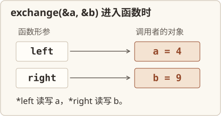

# 程算 05 变量与指针

## 作用域、链接和存储期

在函数里写 `static int calls = 0;`，每次进入这个函数都运行 `++calls`。第一次得到 1，下一次会得到 2。调用者在函数外不能用名字 `calls` 直接访问它，但这块存储在两次调用之间仍然存在。只把 `static` 去掉，改成普通局部变量，每次又会从 0 开始。

这里有两个独立的问题：这段代码能否用这个名字，叫**作用域**；这个对象在什么时候存在，叫**存储期**。多个地方用了同一个名字，还要问这些声明是否指向同一个实体，这才涉及**链接**。

| 对象 | 名字在哪可用 | 数据何时存在 |
| --- | --- | --- |
| 普通块内变量 | 从声明处到所在块结束 | 进入相应块后，直到退出该次执行 |
| 块内 `static` 变量 | 仍只在所在块内 | 整个程序执行期，连续调用共享值 |
| 文件作用域 `static` 对象 | 声明之后的本文件范围 | 整个程序执行期，名字具有内部链接 |
| `malloc` 得到的对象 | 通过仍然有效的指针访问 | 分配成功后到释放为止 |

同一个名字写进两个源文件，会不会指向同一个对象？进入[[程算 10 多文件程序|分开编译的翻译单元]]，就能检验文件作用域和外部链接的区别。

## 地址也是值

假设调用者手里有两个整数 `a = 4`、`b = 9`，希望函数返回后它们真的交换了值。若直接把 4 和 9 传入函数，形参只保存两个整数的副本，在里面交换副本，调用者的数据没有变化。

改成传 `&a`、`&b`。形参仍按值接收，这次复制的是**对象的地址**。于是 `left` 指向调用者的 `a`，`*left` 便是对 `a` 本身的访问。图中只画对象之间的指向，不依赖这台机器恰好分配了哪个地址。



```c
#include <stdio.h>

static void exchange(int *left, int *right) {
    int saved = *left;
    *left = *right;
    *right = saved;
}

int main(void) {
    int a = 4, b = 9;
    exchange(&a, &b);
    printf("%d %d\n", a, b);
    return 0;
}
```

顺着这三次赋值走：先把 `*left` 的旧值 4 放进 `saved`；再让 `*left = *right`，此刻 `a` 和 `b` 都是 9；最后把 `saved` 写进 `*right`，输出便是 `9 4`。如果第二步就覆盖 `a` 而没有先保存 4，最后一步只能读到两个 9。

给形参 `left` 本身重新赋一个地址，只会改变本次调用里箭头的指向。若要改调用方保存的**指针变量**，可以返回新指针，或把那个变量的地址传给 `T **out`。

访问 `*p` 前须保证对象仍然存在、类型与范围匹配。`NULL` 没有可解引用的对象。对数组中的指针加减整数时，结果可以落在数组内或恰好尾后；尾后指针可作为遍历终点，但不能读取它指向的元素。

函数指针允许把具体操作作为参数，例如 `double (*fn)(double)` 可以统一传入不同的被积函数。调用它时函数签名必须匹配，代码的复用来自「计算步骤固定，具体函数可替换」。

## 解方程时，返回值与输出参数各管什么？

`P5/P59Roots.c` 用一个整数返回实根的数量或错误状态，通过两个 `double *` 写入根。以 $x^2-3x+2=0$ 测试，判别式为 1，返回 2，两个输出值为 2 和 1；换成 $x^2+2x+1=0$，返回 1，两个位置都写入 −1；$x^2+1=0$ 返回 0，调用者应跳过两个输出值。例程还专门报告二次项系数接近零的情况。

测试该接口时，可先将输出变量设成容易识别的值，分别跑“无根”和“两根”两个分支，观察哪条路径执行了间接赋值。该例程用固定绝对阈值检查二次项，足以演示参数传递；若继续处理量级差异很大的浮点系数，判别策略须另行约定。

**课件出处**　第 5 章《变量》 PDF 第 7–19 页比较作用域与存储类别，第 20–29 页从指针变量讲到通过地址访问对象。

## 自检练习

解释为什么返回普通局部变量的地址危险，而把结果写入调用者传进来的地址是可行的。

> [!tip]- 查看参考答案
> 普通自动变量的存储期在退出相应块时结束，随后通过它原先的地址读取值没有定义。调用者提供的对象可以活过本次函数调用，因此只要传入的地址有效，函数写入的值在返回后仍可读取。

[[程算 04 函数|上一篇]] · [[程序设计与算法基础课程笔记|课程目录]] · [[程算 06 数组与字符串|下一篇]]
