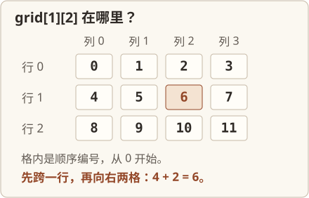

# 程算 06 数组与字符串

## 下标、长度和二维布局

假设 `int a[3] = {4, 9, 2};`，`a[1]` 取得第二个 `int`，即 9。下标 1 指从数组开头向后**跨一个元素**，实际跨多少字节取决于 `sizeof(int)`。长度为 `n` 的数组，最后一个有效下标因此是 `n-1`。

在这里 `sizeof a` 是整个数组的字节数，除以单个元素的大小 `sizeof a[0]` 就得 3。把数组传给 `void visit(int a[], size_t n)` 时，形参 `a` 会调整为[[程算 05 变量与指针|指针]]。函数只拿到首元素的地址，`sizeof a` 现在量的是指针，无法由它倒推出数组长度。这就是接口还要带着 `n` 的原因。

`int grid[3][4]` 可以读作“三个元素的数组，每个元素又是一整行四个 `int`”。找 `grid[1][2]`，行号 1 先跨过第 0 行的四个元素，再在第 1 行跳过两列；所以它在整个矩阵的顺序编号为 `1 * 4 + 2 = 6`，从零开始数。



函数形参 `const int grid[][4]` 会调整为 `const int (*grid)[4]`，每次前进一步跨的仍是一整行。若自己申请了一个平铺的动态数组，就要传行数和列数，再写 `data[row * cols + col]`。另一个常见类型 `int **` 要先取出一根行指针才能定位元素；两种布局不能通过改写形参名字互换。

## 字符串是带边界约定的数组

`char word[4] = "cat";` 一共占四个字符单元，依次是 `'c'`、`'a'`、`'t'`、`'\0'`。`sizeof word` 量整块空间，得到 4；`strlen(word)` 从开头数到第一个空字符为止，得到 3。

假如执行 `word[1] = '\0';`，第三个单元里仍保存 `'t'`，它却已经在字符串的结尾之后了。此时 `strlen(word)` 是 1，`sizeof word` 仍是 4。这个改动把**内容长度**与**可用容量**区分开来。

比较两个以空字符结尾的字符串可用 `strcmp`，结果只保证小于、等于或大于零。用 `fgets` 读一行时，要给它整个缓冲区的可写容量；若换行符已读入，它也算内容的一部分。命令行参数 `argv` 则以空指针 `argv[argc]` 标记指针数组的末端，检查 `argc` 后再取某一个参数字符串。

## 分配、扩容与释放是一条链

- `malloc(n * sizeof *data)` 返回一块未初始化的内存。乘法前检查 `n <= SIZE_MAX / sizeof *data`，分配后检查是否成功。
- 对非零新大小调用 `realloc`，如果失败，旧指针仍指向原分配。用临时变量接收结果，成功后改用新指针并更新容量。若需保留内部元素的位置，扩容前记录下标，成功后用新基址和下标重新定位。
- `free` 由拥有这块内存的一方执行一次。结构体管理动态数组时，常用 `size` 和 `capacity` 区分已使用元素与可容纳元素，并维护 `size <= capacity`。

```c
#include <stdint.h>
#include <stdio.h>
#include <stdlib.h>

int main(void) {
    const size_t count = 3;
    int *values = NULL;
    if (count > SIZE_MAX / sizeof *values) {
        return 1;
    }
    values = malloc(count * sizeof *values);
    if (values == NULL) {
        return 1;
    }
    for (size_t i = 0; i < count; ++i) {
        values[i] = (int)(2 * i);
    }
    printf("%d\n", values[count - 1]);
    free(values);
    return 0;
}
```

变长数组的长度在运行时确定，但会受到编译器支持和自动存储空间大小限制。课程项目需要扩容或让数据跨越函数调用时，显式的动态分配通常更合适。

[[程算 08 数据结构|动态顺序栈]]是这条规则的一个用途。扩容后保留的是元素次序与个数，旧缓冲区中的地址可能已经失效。

## 数字判重与矩阵转置怎样选下标

旧课件《数组》第 23–25 页用长度为 10 的布尔数组记录已见过的十进制数字。输入 28212，从右向左取余得到 2、1、2，第三次取数时 `seen[2]` 已为真，即可回答“有重复”。不必先把所有位排序。对非负整数可用 `do ... while` 至少检查一次，这样输入 0 也遵守“0 含一位数字”的约定。如果题目把 `0012` 当作四个字符，需读字符串，否则前导零会在转成整数时消失。

课程例程 `P65Matrix.c` 对方阵只交换主对角线一侧的元素。对一维缓冲表示的 $n\times n$ 个元素，位置 $(i,j)$ 的下标为 `i*n+j`，和 `j*n+i` 交换，内层只取 `j<i`。若扫过整张矩阵，每对元素会换回原位。若调用方声明的是 `int a[3][3]`，函数形参可写为 `int a[][3]` 并用 `a[i][j]` 访问；声明为 `int *` 的接口则应传入真正的一维缓冲。原例有二维数组直接传给一维指针形参的写法，复习时应一并核对参数类型。

**课件出处**　第 6 章《数组》 PDF 第 36–40 页由动态数组例程引出分配和释放，可配合本页的扩容例子阅读。

## 自检练习

读入长度最多为 31 个字节的字符串，需要准备多大的数组？传给函数时怎样让函数知道可写容量？

> [!tip]- 查看参考答案
> 存放最多 31 个字节的内容，还要给结尾的空字符留 1 个字节，至少分配 char buf[32]。接口可写成 read_word(char *buf, size_t capacity)，在数组定义处传入 sizeof buf。若用 fgets 读整行且换行未读入，还要判断这一行是否有剩余字符。

[[程算 05 变量与指针|上一篇]] · [[程序设计与算法基础课程笔记|课程目录]] · [[程算 07 算法|下一篇]]
