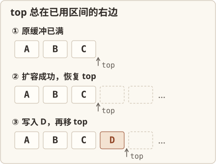

# 程算 08 数据结构

## 从操作出发选择表示

计算器读到 `2 * (3 + 4)` 时，乘号要等括号算完，等在它后面的加号却会先用到。把运算符记成一叠，每次只取最近放下的一个，恰好是**栈**的后进先出。这个规则只约束取放次序，至于元素是挨着存进数组，还是由节点逐个相连，都能实现它。

C 里可以用[[C 结构体对齐|结构体]]把一只栈的状态保存在一起。用对象名访问字段写 `stack.size`，手里是结构体指针时写 `ptr->size`。同样的方法也能描述点的 `x`、`y`，以及链表节点的值和后继指针。枚举适合表示一组有限类别，例如分词器认出的数字、运算符与括号；下方代码用 C17 的 `<stdbool.h>` 表示操作成功与否。

选表示时先问“哪一种操作最频繁”。若只访问栈顶，数组只需在末端移动下标；若经常在已知位置接入或摘下节点，单链表只需修改相邻的指针。把这些动作封成 `StackInit`、`StackPush`、`StackFree` 等接口，调用者只需知道各操作在什么条件下会成功。

| 结构 | 常用操作 | 边界 |
| --- | --- | --- |
| 动态数组栈 | 尾部入栈、出栈、看栈顶 | 空栈不能读顶，容量不足要扩容。按倍数增长时，连续入栈的摊还成本通常是 $O(1)$ |
| 单链表 | 头插、沿 `next` 遍历、删除已知前驱之后的节点 | 头插可 $O(1)$。按下标找节点通常 $O(n)$。要删除当前头节点，必须更新头指针 |
| 泛型容器 | 用 `void *` 接收不透明地址，或者按元素字节大小复制 | 接口要约定谁负责释放、容器是保存指针还是保存值。`void *` 本身没有可直接解引用的元素类型 |

定长栈可以先把边界测试清楚，再把存储替换成动态数组。下面用 `size` 表示已存元素数，非空时栈顶是 `items[size - 1]`。

```c
#include <assert.h>
#include <stdbool.h>
#include <stddef.h>

enum { STACK_CAPACITY = 4 };

typedef struct {
    int items[STACK_CAPACITY];
    size_t size;
} IntStack;

static bool push(IntStack *stack, int value) {
    if (stack->size == STACK_CAPACITY) {
        return false;
    }
    stack->items[stack->size++] = value;
    return true;
}

static bool pop(IntStack *stack, int *out) {
    if (stack->size == 0) {
        return false;
    }
    *out = stack->items[--stack->size];
    return true;
}

int main(void) {
    IntStack stack = {0};
    int value = 0;
    assert(!pop(&stack, &value));
    for (int i = 0; i < STACK_CAPACITY; ++i) {
        assert(push(&stack, i));
    }
    assert(!push(&stack, 5));
    assert(pop(&stack, &value) && value == 3);
    return 0;
}
```

这些 `assert` 是开启断言时运行的演示断言。实际业务代码应显式处理 `push` 和 `pop` 返回的状态，不依赖断言运行操作。

删链表节点的顺序很重要。先保存待删节点的 `next` 并把它接回原链，再释放节点。释放后不能再读 `node->next`。整个链表销毁时对每个节点都遵循这条顺序。若链表另存了尾指针或长度，删除最后一个节点时要一起更新。

## 动态顺序栈扩容后，栈顶在哪里？

课程例程 `P8/P82Stack.c` 用 `base` 记首地址，用 `top` 指向下一处可写的位置。假定容量为 3，依次压入 A、B、C，那么已用区间为 `[base, top)`，`top == base + 3` 恰好落在数组尾后。此时问栈顶元素是什么，要回一个格读 `top[-1]` 才是 C；空栈 `base == top` 时则没有这个格子。



再压入 D 会用到第 4 个格。扩容前先记下已有 3 项，申请更大空间。如果成功，即使整个缓冲区换了位置，三个元素的先后次序仍在。用新首地址算 `top = base + 3`，写入 D，再让 `top` 前移一格。现在第一次出栈应得到 D，第二次应得到 C。

对非零大小的扩容申请，用临时指针接收 `realloc` 的返回值；若失败，原缓冲和栈中的 A、B、C 仍可照常使用。上图只画新缓冲区的前五格。原例每满一次增加 10 项；假如每次都要搬家，扩到 10、20、30……项时，搬移量加起来是一个等差数列，压入 $n$ 项的最坏累计搬移量可达 $O(n^2)$。若容量改为成倍增长，历次搬移量构成等比数列，总和为 $O(n)$。

[[程算 课程设计 表达式计算器|表达式计算器]]先用栈暂存尚未输出的运算符，再用另一只栈保存后缀求值的中间结果。

**课件出处**　第 8 章《数据结构》 PDF 第 10–17 页讲简单栈与进制转换，第 31–40 页展开动态顺序栈的操作与测试。

## 自检练习

画出 `push(3), push(8), pop(), push(5)` 后的栈。删除单链表唯一节点时，头、尾、长度各变成什么？

> [!tip]- 查看参考答案
> 初始为空时，依次入栈 3、8，弹出的是 8，最后从栈底到栈顶为 3、5。若链表同时维护头指针、尾指针和长度，删去唯一节点后两端都应为空指针，长度为 0。

[[程算 07 算法|上一篇]] · [[程序设计与算法基础课程笔记|课程目录]] · [[程算 09 文件|下一篇]]
