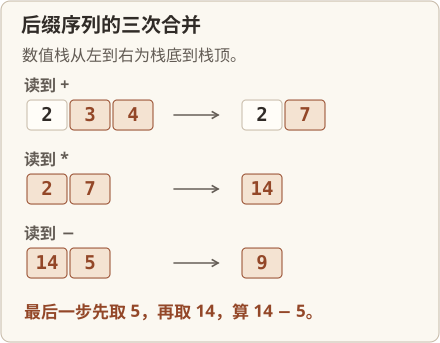

# 程算 课程设计 表达式计算器

## 输入和错误先约定清楚

把 `2 * (3 + 4) - 5` 交给一个从左往右读字符的程序。读完 `2 *` 就做乘法显然太早了，连第二个数都还没有；读完 `3` 时仍然不能动手，因为乘号的右边是整个括号。要让程序把这件事记清，可以将问题分成三步：先[[从字符到表达式语法树|认出数字与符号]]，再排好先做后做的次序，最后执行。

题面要求从键盘读入用数字、小数点、四则运算符和圆括号写成的表达式。这一页的示例另外约定支持一元正负号。错误信息可以带输入位置，这样分词时能指出认不出的字符，解析时能指出缺少的操作数或括号，求值时才检查除数是否为零。

| 模块 | 输入 → 输出 | 第一批要写的测试 |
| --- | --- | --- |
| 分词 | 字符串 → 带位置的数字、运算符和括号 | `12.5` 是一个 token，`1..2` 拒绝，数字之间不能直接省略运算符 |
| 解析 | token → 按优先级排好的后缀序列 | `2+3*4` 与 `(2+3)*4` 的顺序不同，检查括号不配对 |
| 求值 | 后缀序列 → 数值或错误 | 减法与除法的左右顺序，操作数不足，除以零 |
| 界面 | 输入行或错误位置 → 用户看到的输出 | 空白行、超长输入、正常数值的显示 |

第一版可以先限制数值语法为整数或十进制小数，然后用 `strtod` 将确认过格式的数字 token 转为 `double`。如果直接用 `strtod` 匹配原始字符串，还要根据题目要求约束它识别的其他写法，并检查结束指针和范围状态。

## 用运算符栈把中缀转成后缀

后缀写法把操作写在它所需要的数之后。`3 + 4` 写成 `3 4 +`，求值程序因此读到 `+` 时已经见过两个数。转换时，我们可以立即输出数字；遇到运算符却要问一句，它右边的运算对象是否已经完整？尚需等待的符号就存在栈里。

例如读 `2 + 3 * 4`，看到乘号时，`+` 的右边还包含一个乘积，加号继续等，乘号先压在上面。如果把这一项换成 `8 / 4 / 2`，第二个除号到来时，第一个除法必须先完成。这两次决定给出了取栈顶的规则：栈顶优先级更高就输出；同级且当前二元运算符左结合，也先输出旧的。左括号暂时隔开内外两层，遇右括号就输出本层等待的符号直到配对，最后丢弃括号本身。输入结束时将剩余运算符依次输出，若还留有括号则报错。

`2 * (3 + 4) - 5` 的过程如下。表里的栈从左到右是栈底到栈顶。

| 已处理到 | 运算符栈 | 后缀输出 |
| --- | --- | --- |
| `2 * (` | `* (` | `2` |
| `3 + 4` | `* ( +` | `2 3 4` |
| `)` | `*` | `2 3 4 +` |
| `- 5` | `-` | `2 3 4 + * 5` |
| 行末 | 空 | `2 3 4 + * 5 -` |

一元 `-` 和二元 `-` 要分开。行首、左括号后、二元运算符后通常在等待操作数，此时遇到 `-` 应标记为一元负号。已经读完一个数字或右括号后遇到 `-`，才是减法。可以用 `expect_operand` 保存这个状态，给前缀符号单独的 token 和较高优先级。若支持连续的一元符号，按从右向左结合处理，例如 `--2` 表示对 `-2` 再取负。遇到 `2(3+4)` 时应报告缺少运算符，除非需求明确允许隐式乘法。

转换只依赖取栈顶、入栈和出栈。需要自行实现这些操作时，可以回看[[程算 08 数据结构|顺序栈的存储与边界]]。

## 用数值栈求值并测试

现在可以丢开第一个栈，单独读表中最后一行的后缀序列。遇到数值就压栈，遇到二元运算符就拿出**右操作数**和**左操作数**，完成运算后再把结果压回。下面是同一个算例的求值过程，括号里的 `3 + 4` 算完后，留下的 `7` 刚好成为乘法的右操作数。

最后一个 `-` 收到的两个数按出栈次序是 5、14。若照这个次序直接做减法，会读出错误的 −9；应该计算 `14 - 5 = 9`。一元符号只需一个数，每个符号都先检查栈中有足够的操作数。所有 token 处理完，恰好剩下一个值才算成功。若仍有多个值，说明至少有两个数从未被运算合并；若使用定长栈，压入前还应检查是否已满。

| 测试输入 | 期望 | 检查点 |
| --- | --- | --- |
| `2 + 3 * 4` | `14` | 乘法优先 |
| `(2 + 3) * 4` | `20` | 括号改变顺序 |
| `8 / 4 / 2` | `1` | 同级除法左结合 |
| `-(2 + 3) * 1.5` | `-7.5` | 一元负号、括号和小数 |
| `10 - 3` | `7` | 二元操作数的弹栈顺序 |
| `1 / (2 - 2)` | 除零错误 | 求值错误传回界面 |
| `3 +`、`(3 + 2`、`1..2` | 分别报错 | 结束状态、括号和数字格式 |

先让分词器输出 token，再让解析器输出后缀序列，最后接求值器。这样算错时可以判断故障在读数、优先级还是执行阶段。中间输出可用于单元测试。双栈法可以省去保存后缀序列的空间。每次弹出运算符时，立即从数值栈取操作数，计算后把结果压回数值栈。

**课件出处**　《课程设计 2026》 PDF 第 2 页列出计算器的任务要求；中缀转后缀及后缀求值的演算见第 10 章《大型程序》PDF 第 11–14 页。

## 用一组输入做现场演示

两份《课程设计 2026》第 2 页列出的基本输入一致，都要求从键盘读一个由数字、小数点、四则运算符和圆括号组成的表达式。一份提示对照教材第 10 章，另一份调整了这句提示。可以准备三次连续演示：先用 `8/(3-1)+0.5` 算出 4.5，展示从分词到求值的正常路径；删去右括号，核对程序能否指出未闭合的位置；再切换为 `8/(2-2)`，解释语法成立而求值仍会失败的原因。

课件第 4、6 页把编码规范、测试以及现场改错列在考核要点中。若被要求扩展运算符，先说明涉及哪些模块，再给该新运算写一个能和旧运算区分开的测试。上面三组演示输入是整理时补写的。

若减法算出了相反数，可用[[程算复习导图与课件问答|减法弹栈顺序的最小用例]]把错误定位到解析或求值。

[[程算 10 多文件程序|上一篇]] · [[程序设计与算法基础课程笔记|课程目录]] · [[程算 开发环境与调试|下一篇]]
