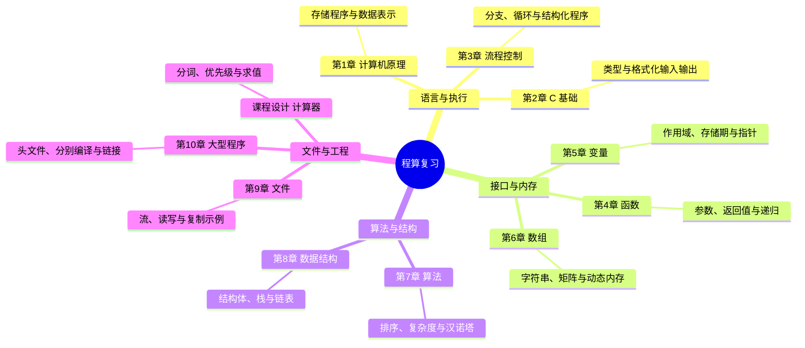

# 程算复习导图与课件问答

[[程序设计与算法基础课程笔记|返回课程目录]]

## 思维导图

## 跨章问答

### 为什么传入数组后仍要传长度？

函数形参中的数组声明会调整为指针。指针让函数可以访问调用者提供的元素，长度则告诉它访问的边界。写入字符串时还要传可写容量，给结尾的空字符留位置。见 [[程算 05 变量与指针]]、[[程算 06 数组与字符串]]。

### 文件复制怎样区分结束和错误？

用 `int` 保存 `fgetc` 的结果，遇到 `EOF` 后检查 `ferror`；块读取则先处理成功读出的字节，再判断流的错误状态。写入和关闭也可能失败。课堂例程见第 9 章《文件》PDF 第 22–25 页的 P91Copy，块读取与写入失败的检查见[[程算 09 文件|文件复制的完善例程]]。

### 怎样定位计算器把减法算反的原因？

用 `10 - 3` 作最小用例。若后缀序列已经是 `10 3 -`，解析顺序正确。求值时第一次弹出的 3 是右操作数，第二次弹出的 10 是左操作数。见 [[程算 课程设计 表达式计算器]] 和 [[程算 开发环境与调试]]。

## 自测

1. 手推 `2 + 3 * 4` 和 `(2 + 3) * 4` 的后缀表达式与两个计算结果。
2. 说明怎样用指针参数同时返回两个结果，并解释调用者为什么看得到变化。
3. 画出 `main.c`、`stack.h`、`stack.c` 的依赖关系，说明声明和定义分别放在哪里。
4. 写出文件复制的伪代码，标出打开失败、正常结束和关闭的位置。
