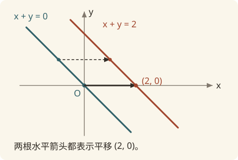

# 线代 基础解系与非齐次通解

[[线性代数课程笔记|返回课程目录]] · [[线代 向量组的秩与换基|复习主元列与线性表示]] · [[线代 期末综合练习|练含参方程与解的组合]]

课堂笔记第 38–40 页，§4.4。先用秩确定方程组有没有解、有几个自由变量，再从行简化后的方程写通解。这里 $A$ 是 $m\times n$ 实矩阵，$n$ 是未知量的个数，记 $r=r(A)$。

对应教材为《线性代数与空间解析几何》（第六版）§4.4（139 页起）。

## 齐次方程为何有 $n-r$ 个独立方向（第 38 页）

把 $A$ 乘上零向量，一定得到零。真正值得问的是：除了零，还能沿什么方向移动，使 $Ax$ 保持为零？

把 $A$ 的各列记为 $\alpha_1,\ldots,\alpha_n$。方程 $Ax=0$ 就是 $x_1\alpha_1+\cdots+x_n\alpha_n=0$。若存在一组不全为零的系数，这些列便线性相关；放到阶梯形里看，就有至少一列没有主元，即 $r<n$。方阵时，也可以用 $\det A=0$ 判定。

所有这些解放在一起便是零空间 $\ker A$。它确实对线性组合封闭：若 $Au=Av=0$，任取实数 $s,t$，就有 $A(su+tv)=sAu+tAv=0$。

一组基础解系是零空间的一组基，即各向量本身是解、彼此线性无关，且能表示全部解。求法：

1. 对 $A$ 作初等行变换得到简化阶梯形，认清 $r$ 个主元变量及剩下的 $n-r$ 个自由变量。
2. 用自由变量表示主元变量。把自由变量依次取为标准单位向量，逐次回代，得到 $\xi_1,\ldots,\xi_{n-r}$。写解向量时按题目原来的变量顺序排列。
3. 各 $\xi_j$ 的自由分量组成单位阵，保证线性无关；任意自由变量取值 $(t_1,\ldots,t_{n-r})$ 对应的解正是 $\sum t_j\xi_j$。所以 $\dim\ker A=n-r$。$r=n$ 时只有零解。

**第 38 页例。** 化简后得到 $x_1=(2x_3+3x_4)/7,\ x_2=(5x_3+4x_4)/7$。取 $(x_3,x_4)=(1,0),(0,1)$，得

$$
x=s\begin{pmatrix}2/7\\5/7\\1\\0\end{pmatrix}
 +t\begin{pmatrix}3/7\\4/7\\0\\1\end{pmatrix},\qquad s,t\in\mathbb R.
$$

基础解系不唯一，两列分别乘 $7$ 也仍是基础解系。一般地，与原基础解系等价且线性无关的向量组也可作基础解系，因为两组的张成空间相同（第 39 页例 6）。

## 用解空间估计矩阵的秩（第 39 页）

**例 7。** 设 $A,B$ 为 $n$ 阶方阵且 $AB=0$，证 $r(A)+r(B)\le n$。把 $B$ 按列写为 $(b_1,\ldots,b_n)$，则 $Ab_j=0$ 对每一列成立，故 $B$ 的列空间包含在 $\ker A$ 内。取维数得 $r(B)\le n-r(A)$。

**黑板上的两个应用。**

- 对 $n\ge2$ 的方阵，伴随矩阵 $A^*$ 满足 $AA^*=(\det A)I$。$r(A)=n$ 时 $A^*=(\det A)A^{-1}$ 可逆；$r(A)\le n-2$ 时各 $n-1$ 阶子式均为零，所以 $A^*=0$；$r(A)=n-1$ 时至少一个余子式非零，而 $AA^*=0$ 给出 $r(A^*)\le1$，故 $r(A^*)=1$。
- 若 $A^2-A-2I=0$，则 $(2I-A)(I+A)=0$，得 $r(2I-A)+r(I+A)\le n$。两因子相加为 $3I$，又由 $r(U+V)\le r(U)+r(V)$ 得反向不等式，故两秩之和恰为 $n$。秩的次可加性来自 $U+V$ 的每一列都是 $[U\ V]$ 的列的线性组合。

## 非齐次方程是齐次解空间的平移（第 39 页）

先看一个二维补例。方程 $x+y=0$ 的解是一条过原点的直线。沿 $(1,-1)$ 移动，$x$ 每增加一份，$y$ 就减少一份，和保持不变。把右端改成 $2$，这个移动方向仍然有效，但原点已经不能作为出发点了。选一个满足 $x+y=2$ 的点 $(2,0)$，从这里沿同一方向走，就能走遍新的解集。

对一般的 $Ax=b$，先比较 $r([A\ b])$ 与 $r(A)$。两者相等才有解。若有解，取其中任意一个作出发点 $x_p$。为什么确定了出发点和齐次方向，就一定能找全解？分两步验：

1. 已经有了另一个解 $y$，把它与 $x_p$ 相减。$A(y-x_p)=b-b=0$，两解之差一定是齐次方向。
2. 反过来，任取一个齐次解 $\xi$，都有 $A(x_p+\xi)=b+0=b$。沿它走不会离开非齐次解集。

因此用基础解系 $\xi_1,\ldots,\xi_{n-r}$ 表示全部方向，通解就是

$$
x=x_p+t_1\xi_1+\cdots+t_{n-r}\xi_{n-r}.
$$

若 $r=n$，没有自由方向，整张解集只含点 $x_p$。若 $r<n$，至少一个参数可以任取实数，解就有无穷多个。

求特解时把自由变量全取零很方便；求方向向量时，要把方程右端改成零。当 $b\ne0$，把两个特解相加会得到 $A(x_1+x_2)=2b$；取差才给出齐次解。

**第 39 页例。** 化简后为 $x_1=3+x_3,\ x_2=2-2x_3$。取 $x_3=0$ 得 $x_p=(3,2,0)^T$，消去常数后的方向为 $(1,-2,1)^T$，所以 $x=(3,2,0)^T+t(1,-2,1)^T$。

## 系数行列式为零之后还要查什么

《线代公式手册》PDF 第 26 页（印刷页 92）将非齐次方程按秩分类。读这页时要保留“方程组有解”的前提。对奇异方阵，仅凭 $\det A=0$ 还分不出无解与无穷多解，因为右端多出的一列也可能提供主元。

例如固定 $A=\begin{pmatrix}1&2\\2&4\end{pmatrix}$。令 $b=(3,t)^{\mathsf T}$，第二行减去第一行的两倍，就得到 $0=t-6$。因此 $t=6$ 时 $r(A)=r(A\mid b)=1$，可令 $x_2=s$，得 $x=(3-2s,s)^{\mathsf T}$。若 $t\ne6$，则 $r(A\mid b)=2>r(A)$，没有解。这个自拟例子中系数矩阵始终相同，变的是增广列与原有列的关系。

## 已给几个解，怎样反推出通解（第 40 页）

**例 6。** $A$ 是秩为 $1$ 的 $m\times3$ 矩阵，$Ax=b$ 的三个解满足

$$
\eta_1+\eta_2=(1,2,3)^T,\quad
\eta_2+\eta_3=(0,-1,1)^T,\quad
\eta_3+\eta_1=(1,0,-1)^T.
$$

齐次解空间的维数是 $3-1=2$。前两式相减得 $\eta_1-\eta_3=(1,3,2)^T$，第一式减第三式得 $\eta_2-\eta_3=(0,2,4)^T$。两向量不成比例，是一组基础解系。取两解的平均 $(\eta_2+\eta_3)/2$ 就得到一个特解，故

$$
x=\begin{pmatrix}0\\-1/2\\1/2\end{pmatrix}
+s\begin{pmatrix}1\\3\\2\end{pmatrix}
+t\begin{pmatrix}0\\2\\4\end{pmatrix}.
$$

**例 7。** 若 $b\ne0$，已知一个特解 $x_p$ 及对应的基础解系 $\xi_1,\ldots,\xi_{n-r}$，那么 $x_p,x_p+\xi_1,\ldots,x_p+\xi_{n-r}$ 是 $n-r+1$ 个线性无关的非齐次解。先证 $x_p,\xi_1,\ldots,\xi_{n-r}$ 无关：对它们的零线性组合左乘 $A$，得 $c_0b=0$，故 $c_0=0$，其余系数由基础解系无关而全为零。再把新向量组的组合展开成旧向量组的组合即可。

对于任一解 $x=x_p+\sum_i t_i\xi_i$，改写为

$$
x=\left(1-\sum_i t_i\right)x_p+\sum_i t_i(x_p+\xi_i).
$$

这里的系数之和总为 $1$。这是“给出几个非齐次解后取加权平均仍为解”的一般形式，因为 $A\sum_i c_i x_i=(\sum_i c_i)b$。

**例 5。** 已知 $n$ 阶矩阵 $A$ 与 $\displaystyle B=\begin{pmatrix}A&b\\b^T&0\end{pmatrix}$ 同秩，证明 $Ax=b$ 有解。逐次删行、删列不会提高秩，而 $A$ 是 $[A\ b]$ 的子矩阵，$[A\ b]$ 又是 $B$ 的子矩阵，因此 $r(A)\le r([A\ b])\le r(B)=r(A)$。由相容条件得证。
