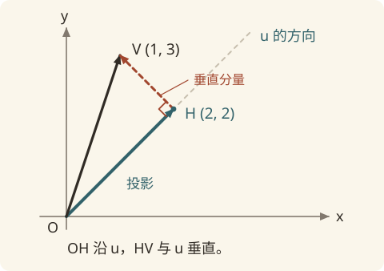

# 线代 空间向量的投影与外积

[[线性代数课程笔记|课程目录]]

课堂第 25–26 页，第三章开头。题目要求“沿某个方向有多长”，用点积；要求公共垂线、平行四边形面积或三角形的高，用外积。两种运算的输出不同，先确定题目要数值还是向量。

对应教材为《线性代数与空间解析几何》（第六版）§3.1–3.2。

## 点积给出夹角和投影（第 25 页）

在空间直角坐标系中，$\overrightarrow{AB}=B-A$。对 $u=(u_1,u_2,u_3), v=(v_1,v_2,v_3)$，
$$
u\cdot v=u_1v_1+u_2v_2+u_3v_3,\qquad
\|u\|=\sqrt{u\cdot u}.
$$
想知道 $v$ 沿着 $u$ 前进了多少，只需要 $u$ 的方向。先把非零向量 $u$ 除以长度，得到单位方向 $e=u/\|u\|$。若 $v\ne0$，点积公式 $u\cdot v=\|u\|\|v\|\cos\theta$ 说明

$$
v\cdot e=\|v\|\cos\theta=\frac{u\cdot v}{\|u\|}.
$$

这个数叫**数量投影**。夹角为钝角时它为负，表示在选定方向上往回走；夹角为直角时它为零。两个非零向量垂直，等价于它们的点积为零。若 $v=0$，投影直接取零，无需求夹角。

若问题要的是落在直线上的那根箭头，就用刚才得到的数乘单位方向 $e$。因此**投影向量**为

$$
\operatorname{proj}_u v=(v\cdot e)e=\frac{u\cdot v}{u\cdot u}u.
$$

用图中的自拟数据核对。取 $u=(1,1)$、$v=(1,3)$，投影向量是 $2u=(2,2)$，所以垂足 $H$ 在 $(2,2)$。剩余分量 $v-2u=(-1,1)$ 与 $u$ 的点积恰为零。这里系数 $2$ 是两倍的 $u$，而数量投影是 $2\sqrt2$：$u$ 本身的长度为 $\sqrt2$。

**例 2。** 已知
$$
a=(-2,2,1),\quad b=(1,3,-3),\quad c=(3,-4,12),\qquad
d=(a\cdot c)b+(a\cdot b)c.
$$
求 $d$ 在 $c$ 方向的数量投影。先算 $a\cdot c=-2,\ a\cdot b=1$，故 $d=-2b+c=(1,-10,18)$。再算 $c\cdot d=3+40+216=259$，$\|c\|=\sqrt{9+16+144}=13$，故数量投影为 $259/13$。若改问投影向量，才需写成 $(259/169)c$。

**两两垂直的三个向量。** 若 $p,q,r$ 的模依次为 $1,2,3$，且两两垂直，则 $\|p+q+r\|^2=\|p\|^2+\|q\|^2+\|r\|^2=14$，所求长度为 $\sqrt{14}$。原页选三个方向为坐标轴，使三个坐标直接成为 $1,2,3$。

## 外积给出垂直方向和面积（第 26 页）

在右手直角坐标系中，$u\times v$ 同时垂直于 $u,v$，方向按右手法则确定；模长 $\|u\|\|v\|\sin\theta$ 是以这两向量为邻边的平行四边形面积。三角形面积再除以 $2$。计算时可用
$$
u\times v=
\begin{vmatrix}
\mathbf i&\mathbf j&\mathbf k\\
u_1&u_2&u_3\\
v_1&v_2&v_3
\end{vmatrix}
=(u_2v_3-u_3v_2,\ u_3v_1-u_1v_3,\ u_1v_2-u_2v_1).
$$
$\mathbf i\times\mathbf j=\mathbf k$，循环轮换保持正号，交换顺序变号。外积对加法分配，标量可提出。两个非零向量平行当且仅当外积为零，此时外积不能用来归一化求公共法向。

**例 1，求两个向量都垂直的单位向量。** $a=(3,-2,4)$，$b=(1,1,-2)$。外积为 $(0,10,5)$，长度 $5\sqrt5$，所有答案是
$$
\pm\frac{(0,2,1)}{\sqrt5}.
$$
直接用点积检验，$a\cdot(0,2,1)=-4+4=0$，$b\cdot(0,2,1)=2-2=0$。正负号对应两个法向。

**例 2，求三角形 $AC$ 边上的高。** 已知 $A=(1,-1,2),\ B=(5,-6,2),\ C=(1,3,-1)$。从同一顶点出发，$\overrightarrow{AC}=(0,4,-3)$，$\overrightarrow{AB}=(4,-5,0)$。其外积为 $(-15,-12,-16)$，模长为 $25$。故
$$
S_{\triangle ABC}=\frac{25}{2},\qquad
h_{AC}=\frac{\|\overrightarrow{AC}\times\overrightarrow{AB}\|}{\|\overrightarrow{AC}\|}
=\frac{25}{5}=5.
$$
这里的高是 $B$ 到直线 $AC$ 的距离。$\overrightarrow{AB}\cdot\overrightarrow{AC}=-20<0$，故垂足在 $A$ 一侧的延长线上；示意图中垂足的位置不能代替这个判断。

**例 3，把方向角和中点条件还原为坐标。** 单位向量 $\overrightarrow{OA}$ 与三个坐标轴正向的夹角相等。点 $B$ 为 $M=(1,-3,2)$ 关于 $N=(-1,2,1)$ 的中心对称点，求 $\overrightarrow{OA}\times\overrightarrow{OB}$。设共同的方向余弦为 $s$，由 $3s^2=1$ 得 $s=\pm1/\sqrt3$；同一个向量的三个分量必须取同一符号。由 $B=2N-M=(-3,7,0)$，得
$$
\overrightarrow{OA}\times\overrightarrow{OB}
=\pm\frac{(1,1,1)\times(-3,7,0)}{\sqrt3}
=\pm\frac{(-7,-3,10)}{\sqrt3}.
$$

取平面内两个不共线方向的外积，就得到一个法向量；再给定平面上一点，便可写出[[线代 混合积与平面方程|平面的点法式方程]]。
