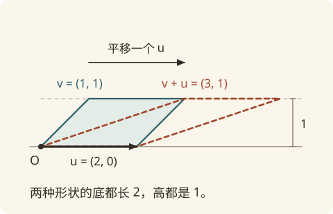

# 线代 行列式的展开与结构计算

[[线性代数课程笔记|课程目录]]

课堂第 14–18、24 页。数字矩阵先找能造零的行或列；字母矩阵先找所有行共有的量、幂次规律或重复的小块。下文按这几种解题入口排列。

对应教材为《线性代数与空间解析几何》（第六版）§2.1–2.3。

## 行列变换与乘积（第 14–16 页）

把二阶矩阵的两列看作平面上的两根箭头。它们围出的平行四边形面积是行列式的绝对值；规定从第一根箭头转到第二根为逆时针时取正号。两列平行，图形就压成一条线，面积为零。

图中取 $u=(2,0)$、$v=(1,1)$。把第二列 $v$ 换为 $v+u=(3,1)$，顶边沿水平方向滑动，底仍长 $2$，高仍是 $1$，行列式仍为 $2$。若改为交换 $u,v$ 的次序，同一块面积的定向会翻转。图中数据为自拟。

同样的操作可用于任意阶行列式。把另一行的倍数加进某行，值不变；交换两行，值变号；把一行乘以 $c$，值也乘以 $c$。由 $\det A^{\mathsf T}=\det A$，这些规则对列也成立。整张 $n$ 阶矩阵乘 $k$ 时，所有行都各乘了一次，所以 $\det(kA)=k^n\det A$。两行或两列成比例时，消去其中一行或一列便得到零，故行列式为零。

初等行变换可写成左乘初等矩阵 $E$，其行列式依次为 $-1,c,1$。用初等矩阵把 $A$ 化为最简形即可得到两个判据：

- $\det A\ne0$ 当且仅当 $A$ 可逆。可逆时最简形是 $I$，不可逆时有零行。
- 对同阶方阵，$\det(AB)=\det A\det B$。可逆时将 $A$ 拆成初等矩阵的积；不可逆时，若 $EA$ 有零行，$(EA)B$ 的同一行也是零行。因此可逆时 $\det(A^{-1})=1/\det A$；同阶方阵若 $AB=I$，取行列式可知 $A$ 可逆，左乘 $A^{-1}$ 即得 $B=A^{-1}$。

**第 14 页例 5，为什么奇数阶实反对称矩阵的行列式总为零？** 反对称给出 $A^{\mathsf T}=-A$。取行列式，左边仍为 $\det A$，右边为 $(-1)^n\det A$。奇数阶时一个实数等于自身的相反数，只能为零。若是偶数阶，这个等式没有给出额外限制。

**第 15 页手写例 13。** 设 $AA^{\mathsf T}=I$ 且 $\det A=-1$。要在 $I+A$ 中用上这两条条件，可先把 $I$ 写成 $AA^{\mathsf T}$，再提取左因子 $A$：

$$
I+A=A(A^{\mathsf T}+I).
$$

右边第二个因子恰是 $I+A$ 的转置，因此 $\det(I+A)=(\det A)\det(I+A)=-\det(I+A)$。可知 $\det(I+A)=0$，再整体乘以 $-1$ 仍有 $\det(-I-A)=0$。

**例 14。** 若 $P^{-1}BP=\Lambda=\operatorname{diag}(0,1,\ldots,n-1)$，把 $I$ 写成 $PIP^{-1}$，与 $B=P\Lambda P^{-1}$ 一起提因子，便有 $I+B=P(I+\Lambda)P^{-1}$。取行列式时 $\det P$ 与 $\det P^{-1}$ 相消。剩下对角阵的对角元依次为 $1,2,\ldots,n$，所以 $\det(I+B)=n!$。

## 先造零或公因子，再降阶

**第 15 页例 8，选主元为 $1$ 的第二列。** 对
$$
D=\begin{vmatrix}1&4&-1&4\\2&1&4&3\\4&2&3&11\\3&0&9&2\end{vmatrix}
$$
作 $R_1\leftarrow R_1-4R_2,\ R_3\leftarrow R_3-2R_2$。按第二列展开，只余第 $(2,2)$ 项。余下三阶行列式中再令 $C_2\leftarrow C_2+C_3$：
$$
D=\begin{vmatrix}-7&-17&-8\\0&-5&5\\3&9&2\end{vmatrix}
=\begin{vmatrix}-7&-25&-8\\0&0&5\\3&11&2\end{vmatrix}
=-5\bigl((-7)11-(-25)3\bigr)=10.
$$

**第 15 页例 9，行和相同。** $n$ 阶矩阵主对角元均为 $x$，其余元均为 $y$。把第 $2$ 至 $n$ 列都加到第一列，列内各元变成 $s=x+(n-1)y$。由第一列线性可提出 $s$，使第一列全为 $1$；其余各行减去第一行后，下方只剩对角元 $x-y$，故 $D_n=s(x-y)^{n-1}$。即使 $s=0$，原式第一列也已经全零。

**第 15 页例 12，各列都有公共部分。** 矩阵的第 $j$ 列除了第 $j$ 项是 $1+a_j$，其余均为 $a_j$。把所有列加到第一列（即 $C_1\leftarrow C_1+C_2+\cdots+C_n$），第一列全变为 $s=1+\sum_j a_j$。提出 $s$ 后，对每个 $i\ge2$ 作 $R_i\leftarrow R_i-R_1$，得到对角线全为 $1$ 的上三角阵，故原行列式为 $1+\sum_j a_j$。

**第 14 页字母题，拆开一列。** 设 $abcd=1$，四行分别取 $t=a,b,c,d$，每行为 $(t^2+t^{-2},\,t,\,t^{-1},\,1)$。把第一列拆开，记 $D=D_1+D_2$。$D_1$ 的各行提出 $t$ 后，剩下的四列可记作 $(t,1,t^{-2},t^{-1})$；$D_2$ 的列为 $(t^{-2},t,t^{-1},1)$，恰是前者按 $3,1,4,2$ 重排，符号为 $-1$。因 $abcd=1$，两项相消。

同一个展开式还能用于验证[[线代 伴随矩阵与克拉默法则|伴随矩阵恒等式]]：原矩阵的一行配上本行的代数余子式得到行列式，配上另一行的则得到零。

## 辨认范德蒙德行列式（第 15 页例 10–11）

第 $j$ 列是 $(1,x_j,\ldots,x_j^{n-1})^{\mathsf T}$ 时，
$$
V_n=\prod_{1\le j<i\le n}(x_i-x_j).
$$
用 $n=2$ 验符号，结果应为 $x_2-x_1$。证明时从末行向上对每一行作 $R_k\leftarrow R_k-x_1R_{k-1}$，第一列除首元外均为零。按第一列展开，余下的每列依次提出 $x_j-x_1$，留下 $V_{n-1}(x_2,\ldots,x_n)$。递推即得结论。交换两个节点的顺序会变号；两个节点相同则为零。

若四行分别为 $(t,t^2,t^3,t^4)$，其中 $t=a,b,c,d$，每行先提出 $t$，再转置还原标准形，答案为
$$
abcd\,(b-a)(c-a)(d-a)(c-b)(d-b)(d-c).
$$

## 多行展开与分块（第 17–18、24 页）

指定 $k$ 行，遍历全部 $\binom nk$ 种 $k$ 列。每种取法给一个子式 $S$，删除所选行列得到余子式 $M$。其[[线代 分块运算与行列式展开|代数余子式]]是 $(-1)^{\sum i+\sum j}M$（行列下标从 $1$ 数起）。拉普拉斯展开是将每个 $S$ 乘以自己的代数余子式后相加。单行展开是 $k=1$ 的情形。

**第 17 页例 1。** 按下面行列式的前两行展开：
$$
\begin{vmatrix}
2&0&1&0&2\\1&0&-1&0&1\\0&1&-1&2&1\\0&2&-2&1&2\\0&1&-1&1&1
\end{vmatrix}.
$$
要避开零列，只需看第 $1,3,5$ 列。第 $1,5$ 列在这两行完全相同，故候选只余 $(1,3)$ 与 $(3,5)$。前者的余子式由第 $2,4,5$ 列组成，第一、三列相同；后者的余子式含原矩阵第一列的三个零。两项均为零，原行列式等于零。

分块三角阵 $\begin{pmatrix}A&*\\0&B\end{pmatrix}$ 或 $\begin{pmatrix}A&0\\ *&B\end{pmatrix}$ 的行列式为 $\det A\det B$，其中 $A,B$ 都是方阵。这可沿一个完整块行展开证明。分块对角阵的幂、逆也可按对应对角块分别计算，求逆时每个块都必须可逆；反对角排列的可逆块，求逆后上下位置互换并各自取逆。

**第 17 页例 3。** 若 $A,B$ 均为 $n$ 阶可逆方阵，$D=\begin{pmatrix}C&A\\ B&0\end{pmatrix}$，交换前后两组列要跨过 $n^2$ 对列，故 $\det D=(-1)^{n^2}\det A\det B\ne0$。设逆为四个未知块，从 $DD^{-1}=I$ 的第二块行先解出左上块 $0$、右上块 $B^{-1}$，再解第一块行：
$$
D^{-1}=\begin{pmatrix}0&B^{-1}\\ A^{-1}&-A^{-1}CB^{-1}\end{pmatrix}.
$$

**第 24 页分块消元。** 对 $Y=\begin{pmatrix}A&B\\ C&D\end{pmatrix}$，若 $A$ 可逆，用第一块行消去 $C$，再消去 $B$：
$$
\begin{pmatrix}I&0\\-CA^{-1}&I\end{pmatrix}
Y
\begin{pmatrix}I&-A^{-1}B\\0&I\end{pmatrix}
=\begin{pmatrix}A&0\\0&D-CA^{-1}B\end{pmatrix}.
$$
左右乘的两阵行列式均为 $1$，故 $\det Y=\det A\,\det(D-CA^{-1}B)$。块乘积要保留原有顺序。

## 相同形状反复出现时，按第一行列递推（第 24 页）

设 $D_n$ 的主对角线都为 $b$，紧邻的上、下对角线分别为 $a,c$，其余全零。按第一行展开，第二项的余子式第一列只有 $c$ 非零，故
$$
D_n=bD_{n-1}-acD_{n-2},\quad D_0=1,\quad D_1=b .
$$
原页例 11 是 $b=\alpha+\beta,\ a=\beta,\ c=\alpha$ 的情形。一般地，取 $\alpha,\beta$ 为 $t^2-bt+ac=0$ 的两根（原题设 $b^2-4ac\ge0$），递推可整理为
$$
D_n-\alpha D_{n-1}=\beta(D_{n-1}-\alpha D_{n-2})=\beta^n.
$$
依次回代得 $D_n=\alpha^n+\alpha^{n-1}\beta+\cdots+\beta^n$。异根时是 $(\alpha^{n+1}-\beta^{n+1})/(\alpha-\beta)$；重根时每一项都为 $\alpha^n$，得 $(n+1)\alpha^n$。
