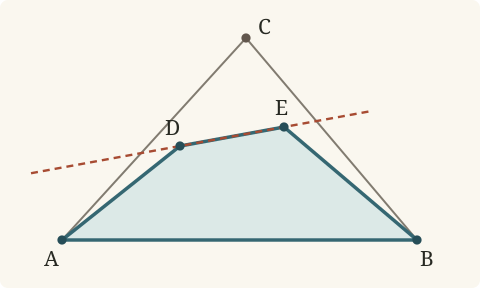

# 五点凸四边形定理

平面上给五个点，任意三点不共线。能否挑出四个，让它们恰好是某个凸四边形的四个顶点？困难的情形是从外面看只看得见一个三角形。

## 先看最外层

想象用一根橡皮筋套住五颗钉子，再让它收紧。皮筋转弯的位置就是凸包的顶点。若它在四颗或五颗钉子处转弯，取其中四颗，沿边界顺序连接就行；每一颗都露在另外三颗围成的三角形外面。

真正需要选点的情形是皮筋只围出了三角形 $ABC$。这时 $D,E$ 藏在里面。直接取 $A,B,C,D$ 会失败，因为 $D$ 被另外三点包住。换一个出发点：先保住两个内点，让它们成为新四边形的一条边。

过 $D,E$ 作直线。由于没有三点共线，这条线不穿过 $A,B,C$ 中的任何一点。直线只把平面分成两侧，三个顶点里至少有两个在同侧，把它们记为 $A,B$。

先用手遮住图中的 $C$。沿虚线看过去，留下的点全在直线的一边或正好在线上，因此橡皮筋碰到 $D,E$ 时会沿着它们之间的线段走。把这个观察写成证明，需要交代四个点各自为什么都留在外沿。

- $A,B$ 本来就是五点凸包的顶点，删去一个点以后，它们仍然是所选四点的极点。
- $A,B$ 都在 $DE$ 的同一侧，所以直线 $DE$ 是这四点凸包的支撑线。支撑线上恰有 $D,E$ 两点，线段 $DE$ 就是一条边。

四个点都是极点，凸四边形就找到了。这一论证也给出了画图时该怎么选点。

## 条件能弱到哪里

只有四个点时，把第四点放在前三点围成的三角形内部，唯一一组四点便不满足条件。允许三点共线时，五个点甚至可以全在一条线上。「凸四边形」要求四点都是顶点，仅仅找到四点并依次连起来并不够。

在计算几何里，令 $v=E-D$，分别计算 $v$ 与 $A-D$、$B-D$ 的二维行列式。它是这两个平面向量嵌入三维后[[线代 空间向量的投影与外积|叉积]]的第三分量。两个结果同号，$A,B$ 就在有向直线 $DE$ 的同一侧。

## 出处

P. Erdős 与 G. Szekeres，*A Combinatorial Problem in Geometry*，刊于 *Compositio Mathematica* 第 2 卷（1935），第 463–470 页。第 463 页记述了 Esther Klein 提出的五点问题。这里按凸包顶点数重写了证明。[原刊扫描](https://www.numdam.org/item/CM_1935__2__463_0/)
