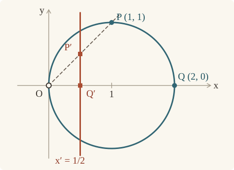

# 圆反演如何把圆化成直线

先在纸上画一条从 $O$ 出发的射线。若 $P$ 距离 $O$ 两个单位，沿同一方向在半个单位处标一个 $P'$。两段距离相乘恰好是 $1$。把 $P'$ 当成起点再做一次，就又回到两个单位处。

这就是半径为 $1$ 的反演。把半径换成 $R>0$，作图规则只需改一处：给定 $P\ne O$，在射线 $OP$ 上找距离 $O$ 为 $R^2/OP$ 的点。这样 $OP\cdot OP'=R^2$。原来离中心越远，像点就越靠近中心；恰在半径 $R$ 处的点留在原位。

写成坐标时，先保住方向，再调整长度。向量 $(x,y)$ 要整体乘以 $OP'/OP=R^2/OP^2$，而 $OP^2=x^2+y^2$，于是

$$
P=(x,y),\qquad P'=\frac{R^2}{x^2+y^2}(x,y).
$$

## 过反演中心的圆

取 $R=1$，考察圆心在 $(1,0)$、半径为 $1$ 的圆。先挑两个好算的点。最右端的 $Q=(2,0)$ 变到 $Q'=(1/2,0)$。最高处的 $P=(1,1)$ 满足 $OP^2=2$，所以 $P'=(1/2,1/2)$。像点高度不同，横坐标却一样。

为什么整圈都有这个巧合？把圆的方程 $(x-1)^2+y^2=1$ 展开，就会得到 $x^2+y^2=2x$。反演公式里原本随着 $P$ 改变的分母，现在可以直接替换。圆上除 $O$ 外有 $x>0$，故

$$
x'=\frac{x}{x^2+y^2}=\frac12.
$$

要证明像是**整条**直线，还要沿反方向走一次。任取 $S=(1/2,t)$，记 $d=1/4+t^2$；它的反演点为 $(x,y)=(1/(2d),t/d)$。代回去有 $x^2+y^2=d/d^2=1/d=2x$，正好落在原圆上。由反演两次能回到原处，直线上的每一点都有来处。只有 $O$ 无法按定义取倒数，图中用空心圈标出。

更一般地，过原点的圆写成 $x^2+y^2=ax+by$。代入反演坐标，就变为 $ax'+by'=R^2$。过中心的直线保持在同一直线上；远离中心的直线则可用上式反向得到一个过中心的圆。

## 什么时候值得换图

若几个圆都过同一个点，可以试着选它当 $O$。两圆的另一个交点会落在两条像直线的交点上，求交或共线问题因此可能简单得多。作图时先标出哪些对象过中心，再决定能化成几条直线。反演一般会改变长度，源图中的等长条件需要通过 $OP\cdot OP'=R^2$ 或其他已证关系重新表达。

在[[动态几何中的自由点与依赖关系|动态几何作图]]中，把 $P$ 约束在原圆上，再由 $P$ 构造 $P'$。拖动 $P$ 可以检查像点是否一直落在直线上；这个结论的证明由上面的坐标等式给出。

## 出处

《反演变换》PDF 第 1 页给出反演的定义与示意图。单位反演圆的坐标计算和一般圆的推导由该定义展开。

[课程资料专题选读](课程资料专题选读.md)
