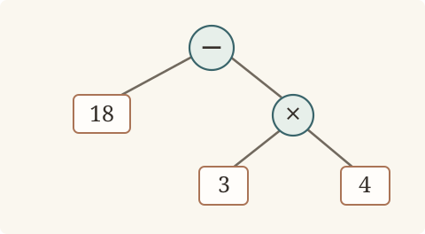

# 表达式语法树

表达式的抽象语法树以运算符为内部结点，以操作数为叶结点。一棵树既能说明谁是谁的操作数，也能解释为什么同样的几项数字换一对括号就会算出不同的结果。

以 `18 - 3 * 4` 为例。[[词法分析]]把字符分成整数、减号和乘号等记号，保留每次出现的顺序。决定乘法属于哪一棵子树，还要用文法。

语法分析器接到的已经是一串记号。下面的文法只考虑非负整数、减号、乘号和括号：

~~~text
表达式 = 乘积 { "-" 乘积 }
乘积   = 原子 { "*" 原子 }
原子   = 整数 | "(" 表达式 ")"
~~~

按第一条规则开始读，`18` 已经可以单独构成一个「乘积」。接着遇到减号，规则要求再读一个完整的「乘积」。这一次，读完 `3` 后下一个记号是乘号，所以 `3 * 4` 要作为一个整体交回给减法。

树从上往下读是结构，从叶子往上算是求值。右边先得到 $3\times4=12$，根结点再算 $18-12=6$。写成紧凑表示就是 `sub(18, mul(3, 4))`。

用括号可以检验这个理解。`(18 - 3) * 4` 先把括号内的减法收成一个原子，整棵树的根换成乘法，结果为 $15\times4=60$。再把输入换成 `18 - 3 - 4`，两个运算优先级相同，按从左往右结合，树便是 `sub(sub(18, 3), 4)`。

## 两类错误落在哪一层

若这个小语言没有字母和井号，输入 `2 # 3` 到井号时，扫描器已经无法产出合法记号。输入 `2 * )` 的每个字符都能分词，但乘号后面应当出现原子，右括号在这个位置放不下，错误出在语法层。输入 `2 3` 也应报错，因此解析入口除了读出一棵树，还要确认已经到达输入末尾。

Flex 和 Bison 一类工具分别可以生成词法扫描器和语法分析器。即使手写计算器，这个分工也有用：改数字格式时先看分词，改优先级时先看文法或运算符栈。[[程算 课程设计 表达式计算器|程算课程设计中的表达式计算器]]给出了用运算符栈处理优先级的另一种写法。

## 出处

John Levine，*flex & bison*，第 2 章及第 3 章分别介绍用 Flex 分词和用 Bison 分析语法。本文用一套只含整数、括号和少量运算符的小文法另拟了算例与错误输入。

[课程专题选读](课程专题选读.md)
